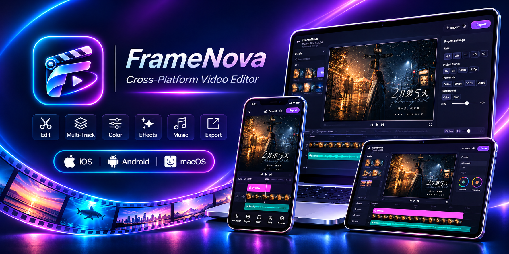

  
  <h1>FrameNova &nbsp;   </h1>
  
<strong>One timeline. Room for every layer.</strong>

  
A multi-track video editor for Android, iPhone, iPad and Mac. Edit on your device, from the first cut to the final frame.

  

    <a href="#features">Features</a> ·
    <a href="#download">Download</a> ·
    <a href="#privacy">Privacy</a> ·
    <a href="#report-a-problem">Report a problem</a>
  

  
<strong>Up to 4K</strong> &nbsp; / &nbsp; <strong>Multi-track editing</strong> &nbsp; / &nbsp; <strong>Local projects</strong>

---

Arrange video, photos, text and sound on a flexible timeline. Edit directly on the preview, build layered
compositions, and keep your projects and imported media on your device. Phone and tablet layouts adapt to portrait
and landscape. On the Mac, a desktop workspace adds a media browser, an inspector and keyboard controls.

## Features

| | What you can do |
| :--- | :--- |
| **Timeline** | Combine a main track with video layers, text and audio tracks. Split, trim, move, duplicate, replace and freeze clips. Zoom and snap to the playhead or clip edges. |
| **Layers & layouts** | Move, scale and rotate layers on the preview. Arrange clips side by side, in grids or as picture-in-picture. Animate position, scale, rotation and opacity with keyframes. |
| **Project format** | Choose a preset aspect ratio or enter your own, such as 16:10 or 2.39:1, when you create a project or later in the editor. |
| **Color & style** | Apply 16 filters with adjustable intensity. Tune brightness, contrast, saturation, warmth, tint, hue, sharpening and vignette. Choose a solid or blurred canvas background. |
| **Transitions** | Connect clips with fades, dips to black or white, directional pushes and slides, and zooms. |
| **Text & subtitles** | Style titles with outlines, shadows, backgrounds, spacing and in/out animations. Add emoji stickers, or import subtitles and lyrics from SRT and LRC files. |
| **Sound & speed** | Add music, extract audio from video, record voiceovers and save a clip's audio as `.m4a`. Adjust volume and see fades in the waveform. Change speed from 0.25× to 4× while keeping the pitch. |
| **Media library** | Browse videos and photos by recent items or album, sort them, and select several items in order. Import audio and other files through the file picker. |
| **Batch tools** | Compress and convert videos, and resize and convert images, without opening the editor. |
| **Export** | Choose 720p to 4K, 24–60 fps, H.264 or HEVC, and three quality levels. |

**Your timeline stays under your control.** Trimming or moving a clip leaves a gap instead of shifting everything
else. Delete a gap when you want to close it; inserting or extending a clip pushes later clips only as far as needed.

**Fonts.** English and display fonts are built in, with comic, neon, retro pixel, script, slab, western and stencil
styles. Traditional Chinese fonts download once, when you ask for them, and then stay on your device.

**Languages and themes.** English and Traditional Chinese, with light, dark and system themes.

**Where exports go.** On Android, exports are saved to `Movies/FrameNova` and can finish in the background, with a
notification. On iPhone, iPad and Mac, share an export or save it to your photo library; keep the app open during
long exports.

## Download

| Device | Get FrameNova | Requires |
| :--- | :--- | :--- |
| Android phone or tablet | [Google Play](https://play.google.com/store/apps/details?id=com.framenova.app), or the APK from [GitHub Releases](https://github.com/daocha/FrameNova/releases/latest) | Android 10 or later |
| iPhone & iPad | [App Store](https://apps.apple.com/app/id6832103216) | iOS / iPadOS 17 or later |
| Mac | [Mac App Store](https://apps.apple.com/app/id6832103216) | macOS 14 or later, Apple silicon |

**About the GitHub APK.** Each release has the APK and a `SHA256SUMS` file to check the download against. The GitHub
version checks this repository for new releases and offers them in the app; Android asks you to confirm each
install. The Google Play and App Store versions update through their stores.

## Privacy

Your projects and media are processed on your device and are not sent to the developer. FrameNova has no account,
analytics, advertising or tracking, and does not sell personal data. The app goes online only for the purposes in
the privacy policy: fonts you ask for, update checks, and a referral service that receives a hashed device
identifier. Read the full [privacy policy](PRIVACY.md).

## Report a problem

Open an [issue](https://github.com/daocha/FrameNova/issues) to report a bug or suggest an improvement. Issues are
public, so leave out personal information and private media.

To include logs, tap the version number in **Settings** ten times to unlock the developer tools. **Developer logs**
shows recent app logs, media-library warnings and errors, and the last crash, with options to copy, share or save
them. On Android, saved logs go to `Download/FrameNova/logs/`. Nothing leaves your device unless you share it. The
tools lock again after the next update or when you turn them off.

## About this repository

This repository hosts FrameNova's releases and privacy policy. The source code is not public. Third-party
libraries and fonts used by the app remain under their own licenses.
